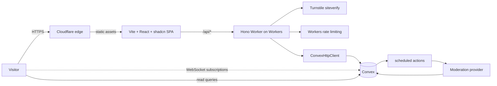

# LinkedOut V1 — Architecture & Build Blueprint

**Status:** draft for review — no code written yet.
**Date:** 2026-11-24
**Source:** shared AFriB conversation `share/fac875c10e0203b5aa4fad52d70a29f0`, adapted to the repo that actually exists here.

---

## 1. What V1 means

The original conversation proposed a 3-phase product. V1 here = **Phase 1 (the safe venting board)**, built with a data model that makes Phase 2 cheap later.

**In scope for V1**

- Anonymous text-only submissions — no accounts, no email, no PII collected
- Company directory, search and per-company pages
- Structured grievance tags (unpaid salaries, toxic management, burnout, …)
- Reactive feed and per-company "toxicity scorecard" that updates live
- Moderation gate: deterministic rules + human review queue, with an AI implementation behind an interface
- Spam controls: Cloudflare Turnstile, single-use submission tokens, rate limits
- Legal scaffolding: disclaimer, ToS, privacy policy, takedown request page

**Explicitly out of scope for V1**

- LLM moderation / auto-tagging with real API keys (interface only; add keys when ready)
- Semantic/vector search
- Image or screenshot uploads (biggest EXIF/PII surface — defer)
- ZKP employment verification, upvote threads beyond "Me Too", follower alerts
- Mobile app, public API

---

## 2. Architecture at a glance



**Key split:** the browser talks to Convex directly for all reactive reads/writes (that is where "reactivity out of the box" comes from). The Worker exists only for privileged edge work: Turnstile verification, rate limiting, single-use token issuance, and future R2/AI work. It never becomes a second source of truth.

---

## 3. Decisions (and what we drop)

| Area | Decision | Why | Rejected |
|---|---|---|---|
| App framework | Keep Vite 8 + React 19 | Already set up; SPA is fine for SEO-light company pages | Next.js (rewrite) |
| UI | Existing shadcn/ui + Tailwind 4 | Already installed in `packages/ui` | New design system |
| Routing | Add `react-router` (v7) | Template has no router; need ~7 pages | TanStack Router (more setup) |
| Data + realtime | Convex (hosted dev deployment for V1) | Reactive queries, transactions, scheduled actions, text search in one | D1 + Durable Objects (would require building pub/sub) |
| Search | Convex `searchIndex` | Reactive full-text search, BM25 + typeahead | Pinecone, Typesense |
| Semantic search | Convex `vectorIndex` in Phase 2 | Built in; no extra vendor | Pinecone |
| Edge | One Hono Worker + Workers static assets | Turnstile, rate limits, zero-logging policy in one place | Separate Pages project |
| AI | `Moderator` interface, rules implementation default | Works without keys; wire vendor later | Vendor locked into V1 |
| Admin | Env-secret gate on review endpoints | Simplest safe gate for V1 | Full auth system |
| Provisioning | `cf` CLI for resources, Wrangler for dev/deploy | Project has no Wrangler config yet; add one in V1 | Ad-hoc dashboard clicks |

The article's GraphQL, Apollo, Prisma, PostgreSQL, Redis/BullMQ, Vercel and Pinecone are all dropped. They duplicate what Convex already provides or solve problems V1 doesn't have.

---

## 4. Repository layout to create

```text
apps/web/
  src/
    main.tsx                 # ConvexProvider + RouterProvider
    routes/                  # page components
      home.tsx
      companies.tsx
      company-detail.tsx
      submit.tsx
      privacy.tsx
      terms.tsx
      takedown.tsx
      review.tsx             # admin-only
    components/              # StoryCard, Scorecard, TagBadge, SubmitForm, …
    lib/convex.ts
  convex/
    schema.ts
    companies.ts
    stories.ts
    tags.ts
    reactions.ts
    reports.ts
    moderation.ts
    stats.ts
    tokens.ts
    seed.ts                  # seeds grievance tag definitions
    _generated/              # generated by `npx convex dev`
  worker/
    index.ts                 # Hono app
  wrangler.jsonc
docs/BLUEPRINT.md            # this file
```

Convex lives inside `apps/web/` so `npx convex dev` runs from that app directory. Root scripts get `dev:convex`/`deploy:convex` equivalents.

---

## 5. Convex data model

```ts
// apps/web/convex/schema.ts
import { defineSchema, defineTable } from "convex/server";
import { v } from "convex/values";

const status = v.union(
  v.literal("pending"),
  v.literal("approved"),
  v.literal("rejected"),
  v.literal("flagged"),
);

export default defineSchema({
  companies: defineTable({
    name: v.string(),
    normalizedName: v.string(), // trimmed + lowercased, dedupe key
    slug: v.string(),
    industry: v.optional(v.string()),
    location: v.optional(v.string()),
  })
    .index("by_slug", ["slug"])
    .index("by_normalized", ["normalizedName"])
    .searchIndex("search_name", {
      searchField: "name",
      filterFields: ["industry", "location"],
    }),

  tagDefinitions: defineTable({
    key: v.string(),        // "unpaid_salaries", "toxic_management", …
    label: v.string(),
    description: v.string(),
    weight: v.number(),     // 1 = subjective friction, 3 = fact-based violation
    category: v.string(),
  }).index("by_key", ["key"]),

  stories: defineTable({
    companyName: v.string(), // denormalized for display/search
    companyId: v.id("companies"),
    title: v.string(),
    body: v.string(),
    tags: v.array(v.string()),
    status,
    flags: v.array(v.string()),
    meTooCount: v.number(),
  })
    .index("by_company_status", ["companyId", "status"])
    .index("by_status", ["status"])
    .searchIndex("search_body", {
      searchField: "body",
      filterFields: ["companyId", "status"],
    }),

  moderationResults: defineTable({
    storyId: v.id("stories"),
    provider: v.union(v.literal("rules"), v.literal("ai"), v.literal("human")),
    verdict: v.union(
      v.literal("approved"),
      v.literal("rejected"),
      v.literal("flagged"),
    ),
    reasons: v.array(v.string()),
    score: v.optional(v.number()),
  }).index("by_story", ["storyId"]),

  reactions: defineTable({
    storyId: v.id("stories"),
    tokenHash: v.string(), // hash of a random single-use token, NOT an identity
  })
    .index("by_story", ["storyId"])
    .index("by_story_token", ["storyId", "tokenHash"]),

  reports: defineTable({
    storyId: v.id("stories"),
    reason: v.union(
      v.literal("defamation"),
      v.literal("pii"),
      v.literal("hate"),
      v.literal("spam"),
      v.literal("other"),
    ),
    detail: v.optional(v.string()),
    status: v.union(
      v.literal("open"),
      v.literal("reviewing"),
      v.literal("removed"),
      v.literal("kept"),
    ),
  })
    .index("by_status", ["status"])
    .index("by_story", ["storyId"]),

  submissionTokens: defineTable({
    tokenHash: v.string(),
    expiresAt: v.number(),
    usedAt: v.optional(v.number()),
  }).index("by_token", ["tokenHash"]),
});
```

**Design notes**

- **No IP, user-agent, email, device fingerprint or account fields anywhere.** `_creationTime` is the only timestamp needed.
- `meTooCount` is denormalized and incremented transactionally in `reactions.add`, with `by_story_token` preventing double-counting. This is what makes counts reactive without a separate counter service.
- Tags are stored as keys referencing seeded `tagDefinitions`; adding a category later is a seed edit, not a migration.
- Phase 2 adds `storyEmbeddings` with a `vectorIndex` whose dimensions match the chosen embedding model. No Pinecone.

---

## 6. Convex function surface

| Function | Kind | Purpose |
|---|---|---|
| `tags.list` | query | All grievance tag definitions |
| `companies.search({ term })` | query | `withSearchIndex("search_name")` |
| `companies.bySlug({ slug })` | query | Company detail |
| `companies.ensure({ name })` | internal mutation | Find-or-create on submit |
| `stories.listRecent({ paginationOpts })` | query | Approved stories, newest first |
| `stories.listForCompany({ companyId, paginationOpts })` | query | Approved stories per company |
| `stories.search({ term, companyId? })` | query | `withSearchIndex("search_body")`, approved only |
| `stats.companyScorecard({ companyId })` | query | Reactive aggregate: total, tag counts, weighted toxicity index, confidence band |
| `moderation.pending()` | query (admin) | Pending/flagged stories + open reports |
| `tokens.issue({ tokenHash, expiresAt })` | internal mutation | Called by Worker after Turnstile succeeds |
| `stories.submit({ token, companyName, title, body, tags })` | mutation | Consumes token, ensures company, inserts `pending`, schedules moderation |
| `moderation.classify({ storyId })` | internal action | Calls `Moderator`, then `ctx.runMutation` to apply verdict |
| `moderation.apply({ storyId, verdict, reasons, score, provider })` | internal mutation | Writes `moderationResults`, updates story status |
| `moderation.override({ storyId, verdict, reason })` | mutation (admin) | Human decision from `/review` |
| `reactions.add({ storyId, token })` | mutation | Idempotent "Me Too" via token hash |
| `reports.create({ storyId, reason, detail })` | mutation | Flag or takedown request |
| `reports.resolve({ reportId, status })` | mutation (admin) | Close report, optionally remove story |

No user auth. Admin mutations compare a secret argument to `ADMIN_SECRET` in Convex env (constant-time comparison); fine for a single-operator V1, revisit before public moderation staff.

---

## 7. Edge Worker

`apps/web/wrangler.jsonc` (shape; exact fields verified against live Wrangler docs during build):

```jsonc
{
  "name": "linkedout-edge",
  "main": "worker/index.ts",
  "compatibility_date": "2026-11-24",
  "assets": {
    "directory": "./dist",
    "not_found_handling": "single-page-application",
    "binding": "ASSETS",
    "run_worker_first": ["/api/*"]
  },
  "vars": {},                         // non-secret values only
  "observability": { "enabled": false } // zero-logging posture; revisit for ops
}
```

Routes:

- `POST /api/turnstile/verify` — rate-limit (Workers Rate Limiting binding, keyed by a salted hash of the IP used only in-memory), call `siteverify`, then generate a random 32-byte token `t`, compute `sha256(t)`, call `tokens.issue` via `ConvexHttpClient`, and return `t` to the client. Convex stores **only the hash**; the raw token exists transiently at the edge and in the client. This prevents bypassing the edge check by calling Convex directly.
- `GET /api/health` — liveness.
- `POST /api/uploads/sign` — deferred; only if images are added later. Would sign an R2 upload and strip EXIF before publishing.
- `POST /api/moderation/classify` — optional alternative path if we want Workers AI instead of a Convex action calling AI Gateway directly. Decide after keys/provider are chosen.

Secrets (via `cf` CLI / `wrangler secret put`): `TURNSTILE_SECRET_KEY`, `CONVEX_URL`, `CONVEX_ADMIN_KEY`, optional `AI_GATEWAY_API_KEY` / `OPENAI_API_KEY`. Client vars: `VITE_CONVEX_URL`, `VITE_TURNSTILE_SITE_KEY`.

---

## 8. Moderation design

```ts
interface Moderator {
  classify(input: { title: string; body: string; tags: string[] }): Promise<{
    verdict: "approved" | "rejected" | "flagged";
    reasons: string[];
    score?: number;
  }>;
}
```

- **`RuleModerator` (V1 default)**
  - reject: threats of violence, slurs, URL/link spam, empty or absurdly short/long submissions
  - flag: emails, phone numbers, street addresses, names of private individuals, possible trade-secret language
  - approve: everything else
- **`AIModerator` (later)** — calls AI Gateway / an LLM with a strict JSON response schema; falls back to `RuleModerator` on error or timeout. Never trusts the model to publish by itself: high-risk categories always go to the human queue.
- **Flow:** `pending` → scheduled `moderation.classify` → `moderationResults` row → story `approved` / `rejected` / `flagged`. Flagged and reported items appear on `/review`.
- **Human override:** `/review` can approve, reject or remove a story and resolve reports.

---

## 9. Frontend routes

| Route | Purpose | Key pieces |
|---|---|---|
| `/` | Home | Hero, search bar, recent approved stories, active companies, trust/disclaimer strip |
| `/companies` | Directory | Reactive search + industry/location filters |
| `/companies/:slug` | Company page | Scorecard, tag breakdown, stories, "Report this story" |
| `/submit` | Submission form | Company autocomplete, title, body, tags, Turnstile, prominent anonymity disclaimer |
| `/privacy`, `/terms`, `/takedown` | Legal | Drafted copy; lawyer review required before launch |
| `/review` | Admin | Moderation queue + reports, not linked in public nav |

Shared components: `StoryCard`, `CompanyCard`, `Scorecard`, `TagBadge`, `SearchBar`, `SubmitForm`, `ReviewTable`, `LegalPage`, toasts via Sonner.

---

## 10. Privacy & legal controls

- **Zero-logging posture:** no request logging in the Worker, no IP/UA persistence anywhere, Convex logs disabled where configurable. IP is used transiently for rate limiting only, salted and never stored.
- **No accounts, no email, no tracking analytics.** Turnstile in privacy-friendly mode.
- **Text-only V1** avoids EXIF metadata entirely. Image uploads, if ever added, require stripping before storage.
- **Takedown flow:** `/takedown` → `reports.create` → admin queue → removal. Demonstrates good-faith moderation for legal protection.
- **ToS/Privacy/Disclaimer copy** I can draft, but a qualified lawyer in your jurisdiction must review before launch. I will not claim legal validity.

---

## 11. Phasing

| Phase | Contents | Rough effort |
|---|---|---|
| **V1** | This blueprint: schema, Convex functions, Worker, UI, rules moderation, legal pages | Buildable in one pass |
| **V2** | LLM moderation, auto-tagging, vector similarity, denormalized scorecards if needed | Add keys + one action |
| **V3** | "Me Too" threads/comments, company right-to-reply, alerting, anonymous verification | Product decisions required |

---

## 12. Build & verification sequence

1. Add dependencies: `convex`, `react-router`, Sonner, shadcn components (`card`, `input`, `textarea`, `badge`, `select`, `dialog`, `skeleton`, `sonner`) via `pnpm dlx shadcn@latest add … -c apps/web`.
2. Run Convex setup from `apps/web` and let it generate `convex/_generated`; verify commands against current Convex docs rather than cached instructions.
3. Write `schema.ts`, seed tags, implement functions in the order: tags → companies → stories → tokens → reactions → reports → moderation → stats.
4. Add `worker/index.ts` + `wrangler.jsonc`; use test Turnstile keys locally.
5. Build UI routes and wire `useQuery`/`useMutation`.
6. Verify: `pnpm typecheck`, `pnpm lint`, `pnpm build`, then browser smoke test — submit → pending → approve in `/review` → story appears; open two tabs and confirm scorecard/count updates without reload.
7. Optionally run Lighthouse and a console-error check; fix anything found.

---

## 13. Open decisions for review

1. **Text-only V1?** Recommended yes — smallest privacy/legal surface.
2. **Rule-based moderation default?** Recommended yes; AI only when keys are supplied.
3. **Convex hosted dev deployment for V1?** Recommended yes; self-host later if data residency demands it.
4. **Router:** `react-router` v7 recommended over TanStack Router.
5. **Admin gate:** env secret recommended for V1.
6. **Convex agent plugins/AI files:** optional, your call — I won't install them from marketing-page instructions.
7. **Visual direction:** shadcn defaults with a custom accent, or do you have brand guidance?
